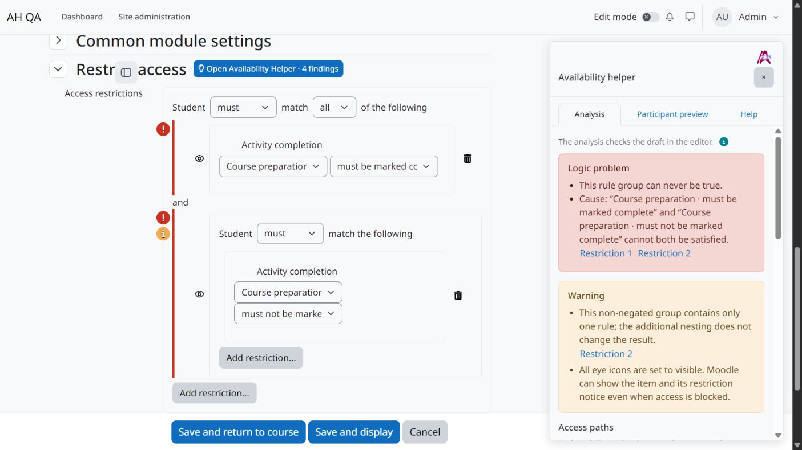
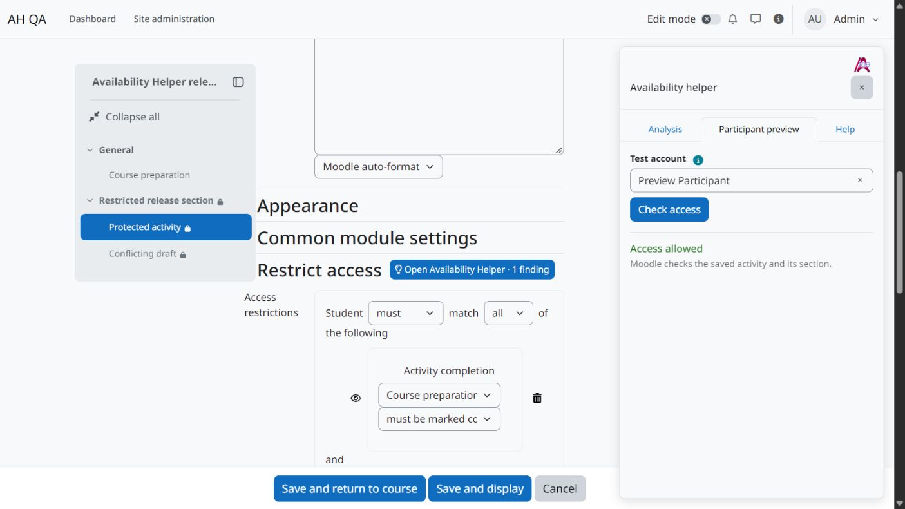
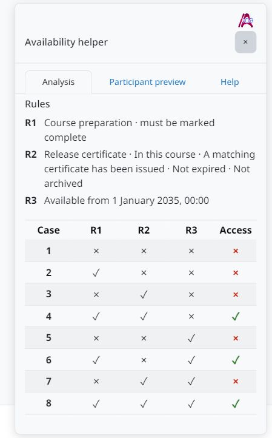
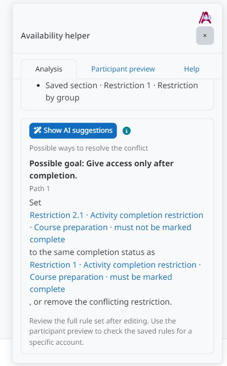

# Availability Helper for Moodle

Availability Helper checks the draft in Moodle’s **Restrict access** editor. It shows which combinations of restrictions could allow access and points to rules that conflict or repeat each other.

[Deutsch](README.de.md)

Screenshots

<table>
<tr>
<td width="50%" valign="top"> <strong>Rule analysis</strong> Find conflicting conditions and jump to the affected rules.</td>
<td width="50%" valign="top"> <strong>Participant preview</strong> Check whether Moodle grants a selected participant access to the saved activity.</td>
</tr>
<tr>
<td width="50%" valign="top"> <strong>Scenario table</strong> Compare eight possible outcomes for three restrictions.</td>
<td width="50%" valign="top"> <strong>AI suggestion</strong> See a possible way to resolve a conflict and open the rules involved.</td>
</tr>
</table>

## Installation

Requires Moodle 4.5, 5.0, 5.1, 5.2 or 5.3 and the PHP version required by the Moodle installation. Enable availability restrictions in Moodle.

Install the ZIP in **Site administration → Plugins → Install plugins**, or place the plugin in `local/availabilityhelper` and complete the installation in **Site administration → Notifications**.

## Check rules in the editor

Open an activity or course section for editing, expand **Restrict access** and select **Open Availability Helper**.

- **Analysis** updates after a short pause in editing. Each access path lists the conditions that must pass together. For activities, the report also includes the saved rules of the containing section as they were when the editor opened. Follow a rule link to jump to that condition. Select a coloured symbol beside a rule to toggle its findings.
- **Participant preview** checks access to the saved activity for an actively enrolled account. Select the account to see the access decision and any reasons Moodle reports. Course editors need the preview permission, permission to view participants and access to all groups. Moodle managers receive the plugin’s preview permission by default.
- **Help** explains the report, preview and settings. The information icons open the relevant topic.

Try adding a condition that requires an activity to be completed. In a nested group, add a condition that requires the same activity to remain incomplete. If both are mandatory, the helper shows the conflict and links both conditions. Edit and save the rules as usual in Moodle.

### Limits of the analysis

The helper detects structural issues such as empty groups and duplicates. It can also recognise known relationships, for example between date limits or completion states for the same activity. Unfamiliar conditions remain open in the logic analysis. For extensions such as Certificate Issued, the participant preview uses Moodle’s actual access decision. The detail of the reason depends on what the condition supplies to Moodle.

The scenario table uses assumed rule outcomes and shows representative cases for larger trees. The participant preview checks access to the activity itself. Features inside an activity can apply their own restrictions.

## Optional AI

AI is off by default. A site administrator can enable it in **Site administration → Plugins → Local plugins → Availability Helper**. The AI features are available on Moodle 4.5 and later with a configured text-generation provider. In automatic mode, Moodle chooses the provider. From Moodle 5.0, administrators can also select a specific provider instance in Availability Helper. Moodle’s AI policy and context settings apply.

**Explain with AI** describes the displayed access paths. When the analysis finds a proven conflict, **Show AI suggestions** offers possible goals and points to rules to review. Review the suggested goals in the editor before changing any rules.

## Data handling

Rule analysis runs in the browser. Participant searches and previews run on the Moodle site. The plugin does not store preview results or log in as the selected account.

An explicit AI request sends rule types, positions, logical polarity and known conflict pairs through Moodle’s AI subsystem. Conflict suggestions may also use symbolic completion states. The request excludes course and activity names, activity identifiers, participant preview data and other rule values. Moodle’s AI subsystem handles the requesting account and context and logs AI requests and responses.

## License

Availability Helper is distributed under the [108design Availability Helper Software License](LICENSE.md), a source-available commercial software license.

This release is available free of charge under the 108design Software License.
